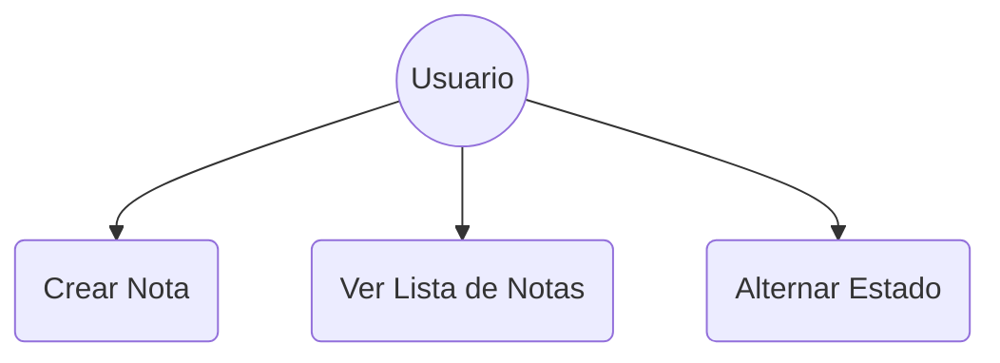
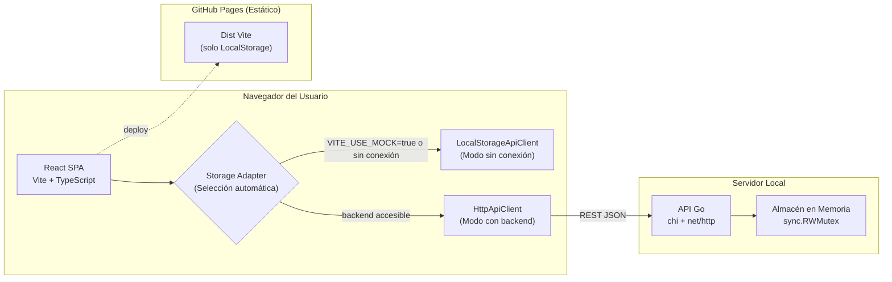
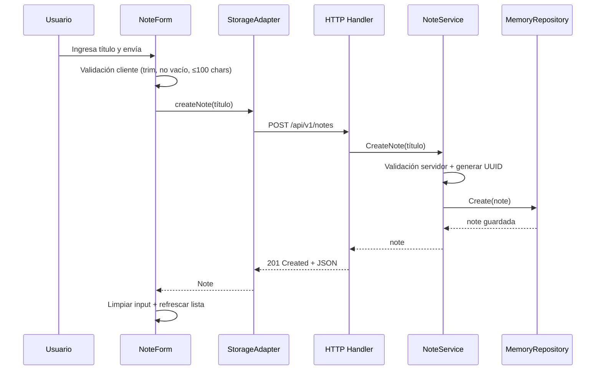

# Diagramas de Arquitectura — StudyNotes / TaskSync

A continuación se presentan los diagramas de arquitectura esenciales para comprender la estructura conceptual del sistema en sus interacciones, de contenedores y los procesos secuenciales de casos de uso principales.

### Diagrama de Casos de Uso UML

### Diagrama de Contenedores C4 Nivel 2

### Diagrama de Secuencia UML (Crear Nota)

