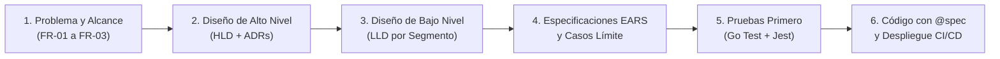

# Guía Docente (Walkthrough de Clase) — De Requisitos a Despliegue en StudyNotes / TaskSync

Este documento es el **guion pedagógico paso a paso** para que el profesor conduzca a la clase a través del ciclo de vida completo de ingeniería de software implementado en `StudyNotes / TaskSync v0.1.0`.

---

## Objetivo Pedagógico de la Sesión

Demostrar con un sistema real y funcional cómo una decisión disciplinada en la etapa de **Ingeniería de Requisitos** se transforma de manera trazable en **Arquitectura**, **Especificaciones formales (EARS)**, **Pruebas Automatizadas (TDD)**, **Código Productivo** y **Entrega Continua (CI/CD)** sin perder coherencia ni caer en *Scope Creep*.



---

## Estructura Sugerida de la Clase (90 – 110 minutos)

| Etapa | Duración | Artefacto Principal | Concepto Clave |
|---|---|---|---|
| **Módulo 1:** Espacio del Problema y Anti-Scope Creep | 20 min | `docs/01-requirements-brief.md` | Problema vs. Solución, INVEST, Gherkin |
| **Módulo 2:** Arquitectura Evolutiva y Rebanadas Verticales | 25 min | `docs/high-level-design.md`, `docs/02-architecture-diagrams.md` | C4 Nivel 2, Patrón Adapter, Costuras (*Seams*) |
| **Módulo 3:** Especificaciones EARS y Auditoría de Bordes | 20 min | `docs/intent/*/*.ears` | Sintaxis EARS (`WHEN... THE SYSTEM SHALL`), Casos Límite |
| **Módulo 4:** Trazabilidad Viva (`@spec`) y Pruebas Primero | 25 min | `backend/internal/**`, `frontend/src/**` | Pirámide de pruebas, mocks, `@spec` en código |
| **Módulo 5:** Calidad en la Fuente y Liberación | 15 min | `.githooks/pre-commit`, `docs/03-release-guide.md` | Shift-Left Testing, SemVer, Keep a Changelog |

---

## Módulo 1: Espacio del Problema y Disciplina Anti-Scope Creep (20 min)

### 1.1 Qué abrir en pantalla
- Abrir `docs/01-requirements-brief.md`.

### 1.2 Narrativa para la clase
1. **Separar el *Qué* del *Cómo*:**
   - Explicar a los estudiantes que un error clásico al iniciar un proyecto es saltar directo a elegir bases de datos o frameworks ("espacio de la solución") sin delimitar el dolor del usuario ("espacio del problema").
2. **Por qué solo 3 requisitos funcionales (`FR-01`, `FR-02`, `FR-03`):**
   - Mostrar la sección **5. Alcance Diferido (`v0.2.0`)** en `docs/01-requirements-brief.md`.
   - Explicar que eliminar notas (`FR-04`), editar texto en línea (`FR-05`) o agregar etiquetas (`FR-06`) son ideas válidas, pero incluirlas en la primera iteración retrasa la validación de la arquitectura de extremo a extremo.
   - Introducir el concepto de **Vertical Slice (Rebanada Vertical)**: es preferible tener 3 funciones que atraviesen UI $\rightarrow$ Adaptador $\rightarrow$ API HTTP $\rightarrow$ Servicio $\rightarrow$ Repositorio con pruebas completas, que tener 15 pantallas a medio construir.
3. **Historias de Usuario INVEST y Gherkin:**
   - Revisar en vivo los criterios `Dado / Cuando / Entonces` de `FR-01` (Crear Nota) y mostrar cómo los escenarios de rechazo (título vacío o mayor a 100 caracteres) ya definen las reglas de negocio antes de escribir una sola línea de Go o TypeScript.

> **Pregunta detonadora para la clase:**
> *"¿Qué pasaría si un usuario envía 50 espacios en blanco como título de una nota? ¿En qué capa debemos validarlo: en el navegador (React) o en el servidor (Go)?"*
> *(Respuesta esperada: En ambas. En el cliente para experiencia de usuario inmediata, y en el servidor por seguridad e integridad de dominio).*

---

## Módulo 2: Arquitectura Evolutiva y Diseño por Segmentos (25 min)

### 2.1 Qué abrir en pantalla
- `docs/02-architecture-diagrams.md` (renderizado con vista previa de Mermaid).
- `docs/high-level-design.md`.
- `backend/internal/domain/note.go`.
- `frontend/src/services/storage/types.ts` y `frontend/src/services/storage/index.ts`.

### 2.2 Narrativa para la clase
1. **Diagrama de Contenedores C4 (Nivel 2):**
   - Señalar cómo el frontend en React no acopla sus componentes visuales (`NoteForm`, `NoteList`) a `fetch()`. En su lugar, conversa con la interfaz `StorageAdapter`.
2. **ADR-002 (Portabilidad Estática mediante el Patrón Adapter):**
   - Mostrar `frontend/src/services/storage/index.ts`.
   - Explicar cómo `createAdapter()` verifica primero `VITE_USE_MOCK === 'true'` y, si no está activo, lanza un *health-check* a `GET /healthz` con un límite estricto de `2000ms` (`AbortSignal.timeout(2000)`).
   - Esto permite que el mismo código corra conectado al backend de Go en desarrollo o en Docker, y también funcione al 100% como demostración interactiva estática en **GitHub Pages** usando `LocalStorageApiClient`.
3. **ADR-001 y Costuras Arquitectónicas (*Architectural Seams*) para `v0.2.0`:**
   - Abrir `backend/internal/domain/note.go` y señalar la interfaz `NoteRepository`:
     ```go
     type NoteRepository interface {
         Create(note Note) (Note, error)
         List() ([]Note, error)
         ToggleStatus(id string) (Note, error)
     }
     ```
   - Explicar que en `v0.1.0` la implementación es `MemoryRepository` (`sync.RWMutex`), pero cuando en la versión `v0.2.0` conectemos **MySQL**, `NoteService` y `NoteHandler` **no cambiarán ni una sola línea de código**.

---

## Módulo 3: Especificaciones EARS y Auditoría de Casos Límite (20 min)

### 3.1 Qué abrir en pantalla
- `docs/intent/notes-api/specs/notes-api-specs.ears`
- `docs/intent/storage-adapter/specs/storage-adapter-specs.ears`
- `docs/intent/notes-ui/specs/notes-ui-specs.ears`

### 3.2 Narrativa para la clase
1. **¿Qué es EARS (*Easy Approach to Requirements Syntax*)?**
   - Mostrar cómo la prosa ambigua se convierte en cláusulas verificables con identificadores únicos (`NOTES-API-001` a `007`, `STORAGE-ADAPTER-001` a `006`, `NOTES-UI-001` a `006`).
2. **Las 4 decisiones de borde que estrecharon la intención antes de codificar:**
   - **Recorte antes de validar (`NOTES-API-002` / `NOTES-UI-001`):** Primero se ejecuta `strings.TrimSpace(title)` / `title.trim()` y después se evalúa si está vacío o supera 100 caracteres.
   - **Atomicidad ante concurrencia (`NOTES-API-005`):** En `backend/internal/repository/memory_repository.go`, `ToggleStatus` protege la lectura, el cambio de estado y la escritura dentro del mismo candado exclusivo (`r.mu.Lock()` / `defer r.mu.Unlock()`), evitando condiciones de carrera (*race conditions*) si el usuario hace doble clic rápido.
   - **Lista vacía como arreglo JSON válido (`NOTES-API-004`):** En Go, un slice `nil` se serializa como `null` en JSON, lo cual rompería `notes.map(...)` en React. Mostrar en `backend/internal/handler/note_handler.go` cómo garantizamos devolver `[]`.
   - **Preservación del texto del usuario ante fallos de red (`NOTES-UI-003`):** En `NoteForm.tsx`, `setTitle('')` solo ocurre dentro del `try` después de que `await onSubmit(trimmedTitle)` resuelve con éxito. Si el servidor falla, el usuario ve el banner de error pero **no pierde lo que escribió**.

---

## Módulo 4: Trazabilidad Viva (`@spec`) y Pruebas Primero (25 min)

### 4.1 Demostración en terminal frente a la clase

Ejecutar en vivo una búsqueda de las anotaciones `@spec` para demostrar cómo las especificaciones EARS están enlazadas directamente con el código y las pruebas:

```bash
grep -rn "@spec" backend/ frontend/src/
```

### 4.2 Recorrido por las pruebas del Backend (Go)
1. Abrir `backend/internal/service/note_service_test.go` y mostrar cómo se prueba la lógica de dominio aislando el repositorio mediante un *mock* en memoria.
2. Abrir `backend/internal/handler/note_handler_test.go` y mostrar las pruebas impulsadas por tablas (*table-driven tests*) con `httptest.NewRecorder()`.
3. Ejecutar en vivo:
   ```bash
   cd backend && go test ./... -v
   ```

### 4.3 Recorrido por las pruebas del Frontend (React + Jest)
1. Abrir `frontend/src/__tests__/NoteForm.test.tsx` y `frontend/src/__tests__/localAdapter.test.ts`.
2. Mostrar cómo se simulan interacciones reales del usuario con `@testing-library/user-event` y se verifican los mensajes en español de México.
3. Ejecutar en vivo:
   ```bash
   cd frontend && npm test -- --passWithNoTests --watchAll=false
   ```

---

## Módulo 5: Calidad en la Fuente (*Shift-Left*) y Despliegue (15 min)

### 5.1 Demostración del Gancho Pre-Commit (`.githooks/pre-commit`)
1. Mostrar el archivo `.githooks/pre-commit`.
2. Explicar el concepto de **Shift-Left Testing**: detectar errores en la máquina del desarrollador antes siquiera de que el commit exista, ahorrando minutos de cómputo en el servidor de CI/CD.
3. *(Opcional en vivo)* Introducir un error temporal en una prueba, intentar hacer `git commit` y mostrar cómo el gancho aborta la confirmación en rojo; luego revertir el cambio.

### 5.2 Ejecución de la Aplicación Completa
Mostrar las dos modalidades de ejecución:

1. **Con contenedores Docker (entorno completo Backend Go + Frontend Nginx):**
   ```bash
   docker compose up --build
   ```
   Abrir `http://localhost:5173`, crear una nota, alternar su estado entre `PENDIENTE` y `COMPLETADO`, y mostrar en las herramientas de desarrollador del navegador las peticiones `POST /api/v1/notes` y `PATCH /api/v1/notes/{id}/toggle`.

2. **En GitHub Pages (modo autónomo sin servidor con `LocalStorageApiClient`):**
   Abrir `https://se-7003-2027.github.io/swe20271-todoapp/` y mostrar el indicador **"Modo sin conexión – los datos se guardan localmente"**, demostrando que las mismas 3 funcionalidades operan en el navegador usando `localStorage`.

---

## Cierre y Puente hacia la Siguiente Clase (CI/CD con Jenkins)

Concluir la sesión resaltando que, aunque el gancho `pre-commit` protege a un desarrollador individual, en un equipo de ingeniería nadie confía únicamente en la máquina local: necesitamos un **servidor de Integración y Entrega Continua (CI/CD)** neutral y reproducible. Ese es el tema del laboratorio práctico en `docs/05-laboratorio-cicd-jenkins.md`.
