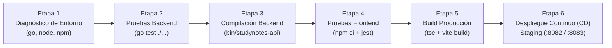

# Laboratorio Práctico de CI/CD — GitHub Actions vs. Jenkins Pipeline

Este documento guía la sesión práctica de **Integración Continua y Entrega Continua (CI/CD)** para el curso de Ingeniería de Software utilizando el proyecto `StudyNotes / TaskSync`.

---

## 1. Propósito Educativo

En la industria encontraremos dos grandes paradigmas de automatización de CI/CD:
1. **CI/CD Nativo en la Nube (SaaS):** Como **GitHub Actions**, donde los flujos se definen en archivos YAML (`.github/workflows/`) y se ejecutan en máquinas efímeras administradas por el proveedor.
2. **CI/CD Auto-Hospedado / Empresarial:** Como **Jenkins**, donde la organización administra sus propios servidores y agentes de compilación, y el flujo se define como código mediante un **`Jenkinsfile`** (Declarative Pipeline en sintaxis Groovy).

Este repositorio implementa **ambos enfoques en paralelo** sobre la misma base de código para que los estudiantes puedan compararlos directamente.

---

## 2. Comparativa Arquitectónica: GitHub Actions vs. Jenkins

| Dimensión | GitHub Actions (`.github/workflows/`) | Jenkins (`Jenkinsfile`) |
|---|---|---|
| **Lenguaje de definición** | YAML declarativo | Groovy DSL (Declarative o Scripted Pipeline) |
| **Hospedaje de cómputo** | Runners efímeros en la nube de GitHub | Contenedor o servidor propio (`docker-compose.jenkins.yml`) |
| **Unidad de aislamiento** | `jobs:` (cada job corre en una VM limpia) | `stages:` (comparten el mismo `workspace` del agente por defecto) |
| **Gestión de herramientas** | Actions comunitarias (`actions/setup-node@v4`, `actions/setup-go@v5`) | Preinstaladas en la imagen del agente (`jenkins/Dockerfile`) o *Global Tool Configuration* |
| **Almacenamiento de artefactos** | `actions/upload-artifact` / GitHub Releases | `archiveArtifacts` integrado en el bloque `post` |

---

## 3. Anatomía del Pipeline de StudyNotes / TaskSync

Tanto en GitHub Actions como en nuestro `Jenkinsfile` en la raíz del repositorio, el pipeline valida y construye las dos capas de la aplicación siguiendo un flujo estricto de compuertas de calidad (*Quality Gates*):



> **Principio clave de CI/CD:** Si la **Etapa 2** (Pruebas del Backend) o la **Etapa 4** (Pruebas del Frontend) fallan, el pipeline se aborta inmediatamente y **nunca** llega a desplegar en el entorno Staging (`http://localhost:8082`).

### Coexistencia de Entornos y Mapa de Puertos

El entorno de despliegue continuo de Jenkins está diseñado para **coexistir sin conflictos** con el entorno de desarrollo local y utiliza el **backend real en Go** (sin forzar el mock):

| Entorno | Puerto | Servicio |
|---|---|---|
| **Desarrollo Local** | `http://localhost:5173` y `:8080` | `npm run dev` (Vite) y API Go local |
| **Servidor CI/CD** | `http://localhost:8081` | Interfaz web de **Jenkins** |
| **Staging Web (CD de Jenkins)** | `http://localhost:8082` | SPA de React desplegada por Jenkins + Proxy Nginx hacia Staging API |
| **Staging API (CD de Jenkins)** | `http://localhost:8083` | Binario `studynotes-api` en Go recién compilado y desplegado por Jenkins |

---

## 4. Guía Paso a Paso: Levantar Jenkins Localmente con Docker

Para evitar que los estudiantes tengan que instalar Java, Jenkins, Go y Node.js manualmente dentro de Jenkins, hemos preparado una imagen personalizada en `jenkins/Dockerfile` y su orquestación en `docker-compose.jenkins.yml`.

### Paso 1: Construir e iniciar el contenedor de Jenkins
Desde la raíz del repositorio, ejecutar:

```bash
docker compose -f docker-compose.jenkins.yml up -d --build
```

> **Nota:** La primera vez tardará entre 1 y 2 minutos mientras descarga `jenkins/jenkins:lts-jdk17`, instala `golang-go`, `nodejs` 20 y preinstala los plugins de Pipeline (`workflow-aggregator`, `git`, `pipeline-stage-view`).

### Paso 2: Obtener la contraseña inicial de administrador
Una vez que el contenedor esté en ejecución, consultar los registros o leer el archivo de secreto directamente:

```bash
docker exec studynotes-jenkins cat /var/jenkins_home/secrets/initialAdminPassword
```

Copiar la cadena alfanumérica que aparece en la terminal.

### Paso 3: Completar el asistente inicial en el navegador
1. Abrir en el navegador: **`http://localhost:8081`** *(usamos el puerto `8081` para dejar libre el `8080` del backend en Go)*.
2. Pegar la contraseña en la pantalla **Unlock Jenkins** y hacer clic en **Continue**.
3. En la pantalla **Customize Jenkins**, seleccionar **Install suggested plugins** (como ya preinstalamos los plugins principales en el `Dockerfile`, este paso terminará rápidamente).
4. Crear el primer usuario administrador (o hacer clic en *Skip and continue as admin*) y confirmar la URL `http://localhost:8081/`.

---

## 5. Configurar y Ejecutar el Pipeline en Jenkins

### Paso 1: Crear el Job tipo Pipeline
1. En el panel principal de Jenkins, hacer clic en **New Item** (Nuevo Elemento / Nueva Tarea).
2. En **Enter an item name**, escribir: `studynotes-tasksync-pipeline`.
3. Seleccionar la opción **Pipeline** y hacer clic en **OK**.

### Paso 2: Conectar el repositorio con el `Jenkinsfile`
1. Bajar hasta la sección **Pipeline**.
2. En el menú desplegable **Definition**, seleccionar **Pipeline script from SCM**.
3. En **SCM**, elegir **Git**.
4. En **Repository URL**, ingresar la URL del repositorio en GitHub:
   ```text
   https://github.com/SE-7003-2027/swe20271-todoapp.git
   ```
   *(Alternativa sin internet en el aula: como `docker-compose.jenkins.yml` monta el proyecto local en `/workspace/todoapp`, también se puede usar `file:///workspace/todoapp` como URL del repositorio).*
5. En **Branches to build → Branch Specifier**, cambiar `*/master` por:
   ```text
   */main
   ```
6. Verificar que **Script Path** diga exactamente:
   ```text
   Jenkinsfile
   ```
7. Hacer clic en **Save** (Guardar).

### Paso 3: Disparar la primera construcción y ver la app desplegada
1. Antes de iniciar el build, abrir en otra pestaña **`http://localhost:8082`** para mostrar la pantalla de espera del entorno **Staging (CD)**.
2. En la página del proyecto `studynotes-tasksync-pipeline` en Jenkins (`http://localhost:8081`), hacer clic en **Build Now** (Construir ahora).
3. Observar en la vista **Stage View** cómo avanzan las 6 etapas en verde:
   - `1. Diagnóstico del Entorno`
   - `2. Pruebas Unitarias — Backend (Go)`
   - `3. Compilación — Backend (Go)`
   - `4. Pruebas Unitarias — Frontend (React + Jest)`
   - `5. Construcción de Producción — Frontend (Vite)`
   - `6. Despliegue Continuo (CD) — Entorno Staging` *(publica el binario en Go y el frontend en el volumen compartido y ejecuta un Smoke Test contra `/healthz`)*
4. Al finalizar la Etapa 6, recargar **`http://localhost:8082`** y usar la aplicación en vivo (conectada a su propio backend en Go recién compilado en `staging-api`, sin usar el mock).

---

## 6. Ejercicios Prácticos para la Clase

### Ejercicio 1: Simular una regresión de negocio y observar el freno del Pipeline
1. Pedir a los alumnos que editen `backend/internal/service/note_service.go` y cambien el límite de validación de `100` a `50` caracteres sin actualizar las especificaciones ni las pruebas.
2. Ejecutar el pipeline en Jenkins (o mediante `.githooks/pre-commit`) y analizar en el **Console Output** qué prueba falla y cómo Jenkins impide que se ejecuten las etapas 3, 4 y 5.

### Ejercicio 2: Agregar una etapa de análisis estático (`go vet`) al `Jenkinsfile`
Pedir a los estudiantes que agreguen una nueva etapa entre las etapas 1 y 2 dentro del `Jenkinsfile`:

```groovy
stage('1.5 Análisis Estático — Backend (go vet)') {
    steps {
        dir('backend') {
            sh 'go vet ./...'
        }
    }
}
```

### Ejercicio 3: Apagar y limpiar el entorno de laboratorio
Al finalizar la práctica, mostrar cómo detener el servidor de Jenkins:

```bash
# Detener el contenedor conservando la configuración y el historial de builds
docker compose -f docker-compose.jenkins.yml down

# Opcional: eliminar también el volumen persistente para empezar desde cero en otro grupo
docker compose -f docker-compose.jenkins.yml down -v
```
